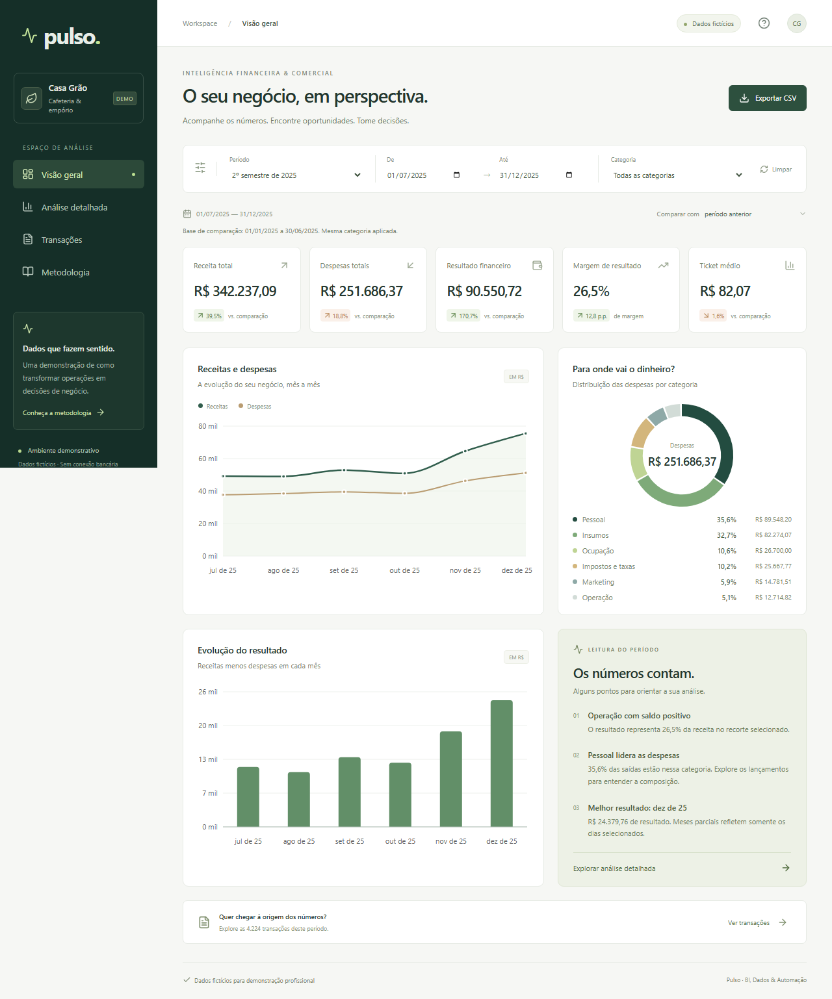

# Pulso

**Inteligência financeira e comercial para pequenos negócios.**

O Pulso transforma registros de vendas e despesas em informações para acompanhar o desempenho do negócio, comparar períodos e investigar os resultados até a transação original.

Projeto de portfólio em **Business Intelligence, Engenharia de Dados e Automação**, com pipeline reproduzível e dashboard interativo.

**Cenário:** Casa Grão, cafeteria e empório fictícios. São **13.673 transações em 24 meses**, de janeiro de 2024 a dezembro de 2025. Todos os dados são sintéticos e utilizados exclusivamente para demonstração.



## Funcionalidades

- **Visão geral:** receita, despesas, resultado, margem, ticket médio e evolução mensal.
- **Análise detalhada:** comparação de períodos, variações e indicadores mês a mês.
- **Transações:** busca, filtros, ordenação, paginação e detalhes dos lançamentos.
- **Sobre o painel:** explicação dos indicadores e orientações de uso.
- Filtros por período e categoria, comparação com período anterior ou ano anterior e exportação dos dados filtrados em CSV.
- Interface responsiva, navegação por teclado e tratamento de carregamento e erros.

## Arquitetura e tecnologias

| Camada              | Tecnologias                             | Aplicação                                                               |
| ------------------- | --------------------------------------- | ----------------------------------------------------------------------- |
| Engenharia de dados | Python e Pandas                         | Geração, validação, limpeza e agregação dos dados                       |
| Dashboard           | React, TypeScript, Vite, CSS e Recharts | Interface interativa e cálculos conforme os filtros                     |
| Validação           | Zod, unittest, Vitest e Playwright      | Integridade da base, consistência dos indicadores e fluxos de navegação |

**Fluxo:** dados brutos → tratamento em Python → dataset validado → dashboard.

Os dados processados acompanham a aplicação. O navegador valida a base e recalcula os indicadores a cada filtro. A arquitetura estática permite hospedar o projeto sem manter um servidor de aplicação em execução.

As fórmulas e os exemplos numéricos estão no [Memorial de cálculo](docs/MEMORIAL_DE_CALCULO_RESUMIDO.md).

## Executar localmente

Requisitos: **Node.js 22.12+** e npm.

```bash
git clone https://github.com/schenten-vinicios/pulso.git
cd pulso
npm ci
npm run dev
```

Abra o endereço informado no terminal. A base demonstrativa já está incluída no repositório.

## Reproduzir os dados

O pipeline usa uma semente fixa e trata tipos, campos ausentes, duplicidades e categorias. Gera transações limpas, agregações mensais, relatório de qualidade e o dataset consumido pelo dashboard.

Em um ambiente **Python 3.12**, execute na raiz do projeto:

```bash
python -m pip install -r requirements.txt
python -m pipeline.run
```

## Qualidade

Os testes verificam as transformações dos dados, os cálculos financeiros, os filtros, a navegação, os detalhes das transações e as exportações em desktop e celular.

```bash
python -m unittest discover -s pipeline/tests -v
npm test
npm run lint
npm run build
npx playwright install chromium
npm run test:e2e
```

## Publicação

O projeto inclui configuração para o **Netlify** em `netlify.toml`: comando de build `npm run build` e diretório de publicação `dist`. Os dados necessários ao dashboard são incluídos no build.

[Análise detalhada](docs/images/pulso-analysis-desktop.png) · [Versão mobile](docs/images/pulso-mobile.png)
