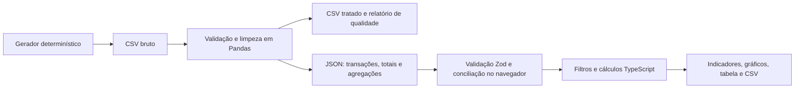

# Pulso

**Inteligência financeira e comercial para pequenos negócios.** Aplicação demonstrativa de BI, engenharia de dados e automação. Todos os dados são fictícios, sem informações de clientes ou conexão bancária.

## Problema e objetivo

Pequenos negócios acumulam registros de vendas e pagamentos, mas nem sempre conseguem enxergar o que mudou, o que consome recursos e quanto sobra da operação. O Pulso transforma esses lançamentos em indicadores claros e permite investigar os números até a transação original.

O cenário é a **Casa Grão**, uma cafeteria e empório fictícios. A base cobre **janeiro de 2024 a dezembro de 2025**, com 13.673 transações válidas: vendas na loja física, online, encomendas corporativas e seis categorias de despesas. Há sazonalidade, crescimento gradual e retração no segundo trimestre de 2025.

## O que funciona

- **Visão geral:** receita, despesas, resultado, margem e ticket, comparação e leituras automáticas do recorte.
- **Análise detalhada:** abre diretamente com a comparação entre períodos, um gráfico comparativo e uma tabela de valores atuais, anteriores e variações. Em seguida, apresenta o detalhamento mensal, sem repetir os cards e gráficos da visão geral.
- **Transações:** busca por descrição, categoria, contraparte ou ID, filtro de tipo, ordenação, paginação e detalhes em modal.
- **Metodologia:** definições, regras de filtros, origem dos dados, qualidade e limites analíticos.
- Filtros globais de período e categoria, datas personalizadas, comparação com período anterior ou mesmo período do ano anterior.
- Exportação CSV do recorte global ou de todos os resultados da busca na tabela, incluindo outras páginas.
- Layout responsivo, navegação por teclado, estados de carregamento, base vazia, erro e nova tentativa.

## Tecnologias e decisões

| Camada | Tecnologia | Por que foi escolhida |
| --- | --- | --- |
| Dados | Python 3.12 + Pandas | Processo reproduzível, legível e fácil de auditar |
| Interface | React 19 + TypeScript | Componentes reutilizáveis e verificação de tipos |
| Build | Vite 6 | Gera arquivos estáticos, sem servidor em produção |
| Visual | CSS responsivo + Lucide | Identidade própria e menos dependências; Tailwind não é necessário neste escopo |
| Gráficos | Recharts 3 | Exploração por tooltip e redimensionamento responsivo |
| Contrato | Zod | Valida o JSON antes de exibir os dados |
| Testes | unittest, Vitest, Playwright | Cobertura das transformações, cálculos e navegação real |
| Hospedagem | Netlify | Publicação estática sem serviços pagos obrigatórios |

Não há backend, banco de dados, autenticação, integração bancária nem API externa. Os dados processados acompanham o código. O navegador lê o JSON e recalcula os indicadores conforme os filtros; as agregações do pipeline são usadas para conferir a integridade da base.

A navegação usa fragmentos de URL (`#overview`, `#analysis`, `#transactions`, `#methodology`). Isso permite abrir diretamente cada área sem adicionar uma biblioteca de rotas. Os filtros persistem durante a navegação, mas são reiniciados ao recarregar a página. As datas e os rótulos mensais usam UTC para evitar deslocamentos de dia por fuso horário.

## Arquitetura



## Estrutura

```text
data/
  raw/transactions.csv          # Base bruta com problemas controlados
  processed/                   # Base limpa, rejeitados, mensal e qualidade
pipeline/
  run.py                       # Geração, leitura, validação e transformação
  tests/test_pipeline.py       # Testes do pipeline
public/
  data/dashboard.json          # Dataset incluído na publicação
src/
  App.tsx                      # Navegação, carregamento e filtros compartilhados
  components/                  # Gráficos, transações e metodologia
  lib/finance.ts               # Contrato, cálculos, períodos e exportação
  lib/finance.test.ts           # Testes dos cálculos e integração com o JSON real
  styles.css                   # Identidade visual e responsividade
e2e/dashboard.spec.ts           # Fluxos desktop e mobile
scripts/start.ps1               # Inicialização facilitada no Windows
docs/MEMORIAL_DE_CALCULO_RESUMIDO.md # Fórmulas e exemplos dos indicadores
docs/images/                    # Capturas selecionadas da aplicação
netlify.toml                   # Build, diretório de publicação e headers
```

`node_modules`, `.tools`, `.cache`, `dist`, `.venv` e resultados temporários estão no `.gitignore`. A implementação Power BI em desenvolvimento, os artefatos de demonstração e a documentação interna também ficam fora do versionamento. O lockfile npm, os dados sintéticos, o memorial resumido e as capturas selecionadas acompanham o repositório. Não envie as ferramentas locais para o Netlify.

## Executar localmente

Pré-requisitos gerais: **Node.js 22.12+**, npm e, somente para regerar os dados, **Python 3.12**. A compatibilidade do Node foi conferida na [documentação do Vite](https://vite.dev/guide/).

```bash
npm ci
npm run dev
```

Abra a URL local informada no terminal, normalmente `http://127.0.0.1:5173`. A base já está gerada: Python não precisa ficar executando para usar o dashboard.

No Windows, com Node.js disponível, também é possível usar o script de inicialização:

```powershell
powershell -ExecutionPolicy Bypass -File .\scripts\start.ps1
```

O script instala as dependências com `npm ci` se `node_modules` ainda não existir e inicia o servidor. Ele também reconhece uma instalação portátil compatível em `.tools`, quando disponível localmente; essas ferramentas não acompanham o repositório. Encerre o servidor com Ctrl+C.

## Reproduzir o pipeline

É recomendável um ambiente virtual dentro do projeto:

```powershell
python -m venv .venv
.\.venv\Scripts\python.exe -m pip install -r requirements.txt --cache-dir .cache/pip
.\.venv\Scripts\python.exe -m pipeline.run
.\.venv\Scripts\python.exe -m unittest discover -s pipeline/tests -v
```

Em Linux/macOS, use `.venv/bin/python` no lugar de `.venv\Scripts\python.exe`. Se Pandas já estiver instalado, basta `python -m pipeline.run`.

Etapas do processo:

1. Gera o CSV bruto com semente fixa `42`. Introduz dois registros duplicados, um registro inválido e duas ausências descritivas para demonstrar o tratamento.
2. Lê o arquivo com Pandas, valida colunas, IDs, datas, tipos, categorias e centavos inteiros positivos.
3. Padroniza espaços, caixa, acentuação e aliases de categorias, como “Matéria prima” e “E-COMMERCE”.
4. Isola registros inválidos em `rejected.csv`. Não estima valores financeiros ausentes. Preenche apenas campos descritivos ausentes.
5. Remove duplicatas idênticas. IDs repetidos com conteúdos diferentes interrompem o processo.
6. Ordena transações, calcula totais e agregações mensais, salva CSVs e o relatório de qualidade.
7. Gera `public/data/dashboard.json` com transações, categorias, metadados, totais, agregações e hash SHA256 do CSV bruto.

O comando regenera os arquivos de dados, substituindo os artefatos anteriores. Para consumir um arquivo real seria necessário separar o gerador e adaptar o contrato; este projeto foi deliberadamente limitado à demonstração fictícia. O hash serve para rastreabilidade local, não é uma assinatura de autenticidade.

Na geração entregue: **13.676 registros recebidos → 13.673 válidos + 2 duplicidades removidas + 1 isolado**. Dois campos descritivos foram preenchidos. Não há aleatoriedade nos componentes visuais.

## Definições dos indicadores

O [Memorial de cálculo resumido](docs/MEMORIAL_DE_CALCULO_RESUMIDO.md) reúne as fórmulas, os exemplos numéricos e as métricas de qualidade da base. As regras de filtros e comparação estão descritas abaixo e na área **Metodologia** da aplicação.

Todos os valores de entrada são positivos; o tipo define se são receita ou despesa. Armazenamos dinheiro em centavos inteiros e só formatamos em reais na apresentação.

| Indicador | Regra |
| --- | --- |
| Receita total | Soma dos valores das transações de receita |
| Despesas totais | Soma dos valores das transações de despesa |
| Resultado financeiro | Receita − despesas |
| Margem de resultado | Resultado ÷ receita; sem receita, indefinida (`—`) |
| Quantidade de vendas | Número de transações de receita |
| Ticket médio | Receita ÷ quantidade de vendas; sem vendas, indefinido (`—`) |
| Variação percentual | (Atual − anterior) ÷ módulo do anterior; base zero gera `—` |
| Variação de margem | Margem atual − anterior, apresentada em pontos percentuais |
| Participação de despesa | Valor da categoria ÷ despesas do recorte |

É uma visão simplificada de **regime de caixa**, sem saldo inicial. Resultado financeiro não é lucro contábil. Cada receita é uma venda; não representa necessariamente um cliente único. Não há impostos calculados em tempo real: os pagamentos sintéticos já fazem parte das transações.

### Filtros e comparação

- Início e fim inclusivos; todos os indicadores usam o mesmo conjunto filtrado.
- Categoria também se aplica à comparação. Uma categoria de despesa zera a receita e deixa margem e ticket indefinidos.
- Períodos com meses completos são comparados com a mesma quantidade de meses imediatamente anteriores. Exemplo: jul–dez/2025 contra jan–jun/2025.
- Recortes personalizados que não contêm meses completos usam a mesma quantidade de dias imediatamente anteriores.
- Comparação anual desloca datas em um ano; 29/02 é ajustado para 28/02 quando necessário.
- Não exibimos variações se o período anterior não estiver integralmente coberto pela base. As transações do período atual continuam disponíveis.
- Meses sem movimento aparecem com zero. Meses parciais incluem somente os dias selecionados.
- Busca, tipo e ordenação na tabela não alteram os KPIs: refinam a tabela e o botão **Exportar tabela**. **Exportar CSV**, no topo, usa apenas os filtros globais.
- Exportações contêm todos os resultados do recorte, não apenas a página visível. Usam UTF-8 com BOM, separador `;`, decimal com vírgula e proteção de campos textuais contra interpretação como fórmulas de planilha.

## Validar

```bash
python -m unittest discover -s pipeline/tests -v
npm test
npm run lint
npm run build
```

Testes de navegador, após o build:

```powershell
$env:PLAYWRIGHT_BROWSERS_PATH = "$PWD/.tools/browsers"
npx.cmd playwright install chromium
npm.cmd run test:e2e
```

O Playwright inicia e encerra automaticamente um servidor local de preview na porta 4173. Feche outro processo que esteja usando essa porta. Em Linux/macOS, use `PLAYWRIGHT_BROWSERS_PATH="$PWD/.tools/browsers"` como variável de ambiente e `npx`/`npm` sem `.cmd`.

Os testes verificam limpeza e rejeição, integridade e reconciliação, cálculos conhecidos, períodos e casos sem base, filtros reais, navegação, tabela, detalhes, exportação, ausência de rolagem horizontal no documento em celular e recuperação de erro. Capturas e arquivos exportados são salvos em `test-results/`, ignorado pelo Git. A navegação mobile é emulada em Chromium, não executada em um iPhone físico.

Para conferir o build manualmente:

```bash
npm run build
npm run preview
```

## Publicar no Netlify

**Nada foi publicado externamente durante a implementação.** Os passos abaixo devem ser executados quando você decidir publicar.

O `netlify.toml` já define **comando `npm run build`**, **pasta `dist`** e Node 22, conforme as [instruções oficiais para Vite no Netlify](https://docs.netlify.com/build/frameworks/framework-setup-guides/vite/). Não é preciso plugin Netlify, função ou serviço externo para esta aplicação estática.

Opção com repositório:

1. Envie o projeto para seu repositório Git, incluindo `package-lock.json` e `public/data/dashboard.json`.
2. No Netlify, importe o repositório e confira o comando e a pasta definidos acima.
3. Publique. O JSON será copiado para `dist/data/dashboard.json` pelo Vite; Python não roda no deploy.

Opção manual:

1. Execute `npm ci` e `npm run build`.
2. Na área de deploy manual do Netlify, envie **o conteúdo da pasta `dist`**, não o projeto inteiro.
3. Os arquivos `_headers` e `_redirects` também acompanham `dist`, para aplicar as mesmas regras na publicação manual. Não há necessidade de enviar o `netlify.toml` junto com `dist`.

Para atualizar a base, execute o pipeline, valide novamente e publique o JSON atualizado junto com a aplicação. Não são necessárias variáveis de ambiente, chaves privadas ou serviços pagos. Limites e condições do plano de hospedagem são definidos pelo Netlify.

Depois da publicação, confira `/`, `/#analysis`, `/#transactions`, `/#methodology`, filtros e download CSV. A publicação remota e os headers reais do provedor só podem ser verificados depois de um deploy autorizado.

## Limitações e escopo

- Dados inteiramente fictícios e estáticos, sem atualização automática.
- Sem integração bancária, edição de lançamentos, previsão, metas, login ou múltiplas empresas.
- Transações carregadas em memória: adequado à base demonstrativa; grandes bases exigiriam outra estratégia.
- Testes de navegador realizados em Chromium desktop e emulação mobile; outros motores e aparelhos físicos não foram verificados.
- O escopo público deste repositório é a aplicação web. A implementação Power BI permanece em desenvolvimento e não integra esta publicação.

## Documentação e capturas

Consulte o [Memorial de cálculo resumido](docs/MEMORIAL_DE_CALCULO_RESUMIDO.md) para conferir os indicadores financeiros e de qualidade dos dados.

Capturas de referência da aplicação:

- Visão geral: [desktop](docs/images/pulso-desktop.png) e [mobile](docs/images/pulso-mobile.png).
- Análise detalhada: [desktop](docs/images/pulso-analysis-desktop.png) e [mobile](docs/images/pulso-analysis-mobile.png).

As capturas ilustram a interface; não substituem a execução dos testes da versão utilizada. Os comandos de validação estão na seção **Validar** deste README.
